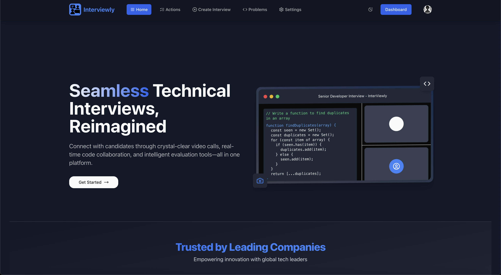
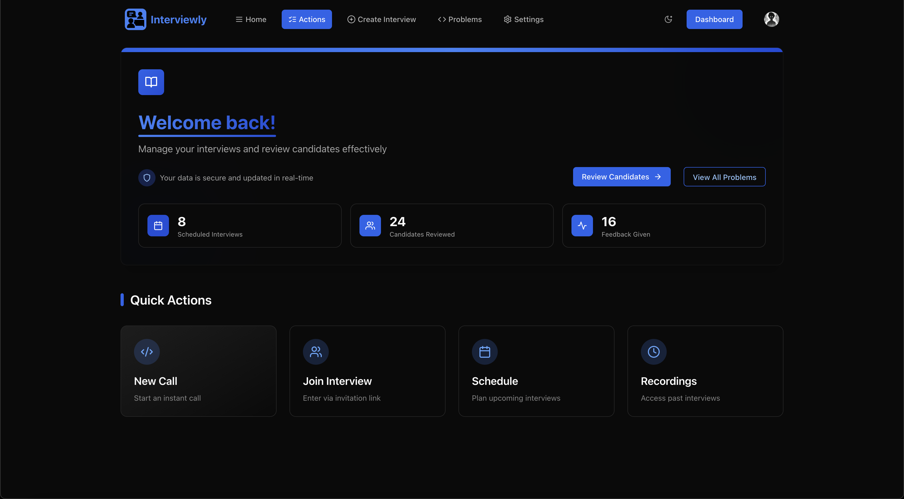
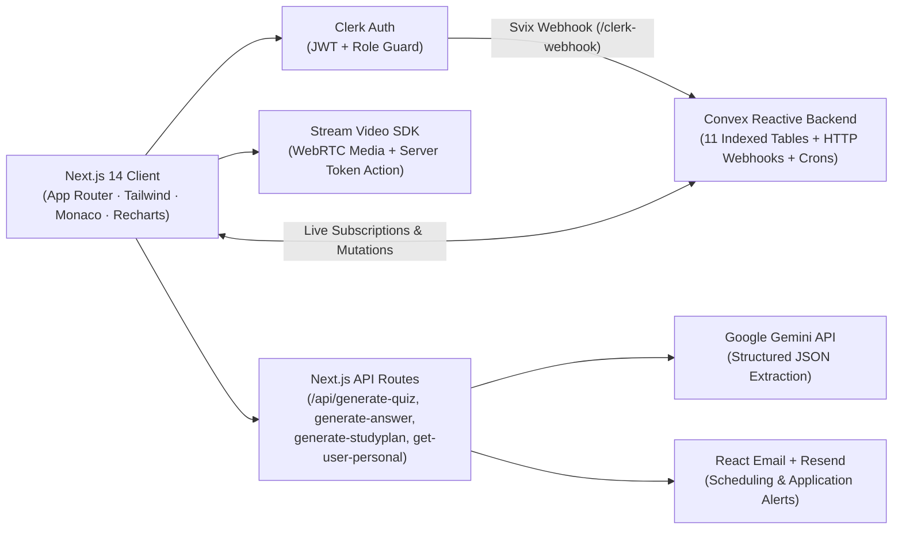

# Interviewly — AI Interview & Recruitment Platform

[](https://interviewly-vert.vercel.app/)
[](https://nextjs.org/)
[](https://www.convex.dev/)
[](https://ai.google.dev/)




## 🎯 Problem Statement

Technical interview preparation and hiring are typically fractured across disconnected tools: candidates juggle spreadsheets for job tracking, separate apps for flashcards/quizzes, static docs for resume building, and ad-hoc video links paired with external editors for mock interviews. **Interviewly** unifies the end-to-end hiring and prep lifecycle into a single real-time platform—combining a role-based job board, **WebRTC video interview rooms** (powered by Stream Video SDK) with an embedded **Monaco code editor**, and **Google Gemini-powered study tools** (personalized flashcards, quizzes, study plans, and resume enhancement) backed by **Convex** for live cross-client synchronization.

---

## 🏗️ System Architecture



```text
Data Model (convex/schema.ts — 11 Indexed Tables):
├── users            (clerkId, role: candidate|interviewer, profile)
├── interviews       (streamCallId, candidateId, interviewerIds[], startTime, endTime, status)
├── comments         (interviewId, interviewerId, rating, content)
├── questions        (coding prompts & solutions)
├── flashcards       (userId, deck/topic, code-formatted Q&A)
├── quizzes          & quizResults (per-question timing, score breakdown, recommendedResources)
├── studyPlans       (userId, target role, skill gap, day-by-day allocated topics)
├── jobs             & jobApplications (status workflow: Pending → Shortlisted → Hired)
└── activities       (real-time notification feed + emailSent tracking)
```

---

## ⚖️ Key Technical Decisions & Trade-offs

| Decision | Why Chosen | Trade-off Considered |
|---|---|---|
| **Convex Reactive Backend** | Real-time subscriptions out of the box with end-to-end TypeScript types (`convex/_generated`)—kept the job tracker, notification bell, flashcards, and interview schedules synced without hand-rolled WebSocket fan-out or cache invalidation. | Introduces platform coupling compared to self-hosted PostgreSQL + Redis, trading infra portability for rapid full-stack reliability. |
| **Stream Video SDK (WebRTC) + Server Actions** | Provides NAT traversal (STUN/TURN), screen sharing, and recording out of the box, with server-side token minting in `src/actions/stream.actions.ts` so secrets never touch the browser. | Less low-level control than a custom mediasoup/LiveKit SFU, which would be preferred at large multi-party enterprise scale. |
| **Defensive JSON Extraction on Gemini Routes** | LLM outputs frequently wrap structured JSON in markdown fences (` ```json ... ``` `) or explanatory text. Dedicated `extractJSON()` parsing + schema validation across `/api/generate-*` routes prevents malformed responses from crashing quiz/study-plan rendering. | Adds minor server-side validation overhead; migrating to strict structured-output response schemas eliminates fence parsing entirely. |
| **Clerk + Svix Webhook Sync (`convex/http.ts`)** | Cryptographically verifies Clerk user lifecycle webhooks via Svix so Convex's `users` table stays synchronized with auth identity and RBAC (`candidate` vs `interviewer`). | Requires careful idempotency on webhook retries and local tunneling during development. |
| **Embedded Monaco Editor in Video Rooms** | Gives candidates and interviewers VS Code-grade syntax highlighting and multi-language editing directly beside the live video call. | Currently acts as an interactive coding pad rather than a sandboxed remote execution engine (see Roadmap below). |

---

## 🚀 Core Capabilities

- **Live Video & Technical Interviews:** Scheduled & instant WebRTC interview rooms via Stream SDK, countdown timers, embedded Monaco editor (`@monaco-editor/react`), interviewer comment/rating workflow, and automated React Email + Resend notifications.
- **AI Prep Suite (Google Gemini):** Auto-generated personalized quizzes with analytics (`Recharts`), code-aware flashcards (`TextWithCode` formatting), day-by-day study plans persisted to Convex (`studyPlans`), and an AI-assisted resume builder with PDF export (`jsPDF` / `html2pdf.js`).
- **Role-Based Job Board & Activity Feed:** Separate candidate and interviewer/employer flows (`ManageJobs`, `PostJob`, application status pipeline) with real-time activity notifications.

---

## 🚧 Known Limitations & v2 Roadmap

1. **Sandboxed Remote Code Execution:** Integrate a containerized code-execution runner (Docker + Linux `cgroups` memory/PID limits + timeouts) behind the Monaco editor so candidates can run and test code against hidden test suites inside live interviews.
2. **Real-Time Collaborative CRDT Editing:** Upgrade the interview editor to Yjs/CRDT multi-cursor synchronization so interviewer and candidate see live keystrokes and cursor positions simultaneously.
3. **API Rate Limiting & Structured Outputs:** Add per-user token-bucket rate limiting on `/api/generate-*` Gemini routes and migrate prompts to Gemini native JSON schema mode with streaming responses.
4. **Automated E2E Verification:** Add Playwright end-to-end tests covering auth flows, job application transitions, and interview room scheduling.

---

## 🛠️ Local Setup

### Prerequisites
- Node.js 18+
- Accounts/keys for **Clerk**, **Convex**, **Stream Video**, **Google Gemini**, and **Resend**

### Run Locally
```bash
git clone https://github.com/priyanshub18/interviewly.git
cd interviewly
npm install

# Terminal 1: Start Convex backend & codegen
npx convex dev

# Terminal 2: Start Next.js dev server
npm run dev
```

Required environment variables (`.env.local`):
```env
NEXT_PUBLIC_CLERK_PUBLISHABLE_KEY=...
CLERK_SECRET_KEY=...
CONVEX_DEPLOYMENT=...
NEXT_PUBLIC_CONVEX_URL=...
NEXT_PUBLIC_STREAM_API_KEY=...
STREAM_SECRET_KEY=...
GEMINI_API_KEY=...
RESEND_API_KEY=...
```

---

## 📄 License

MIT License — see [LICENSE](./LICENSE).
